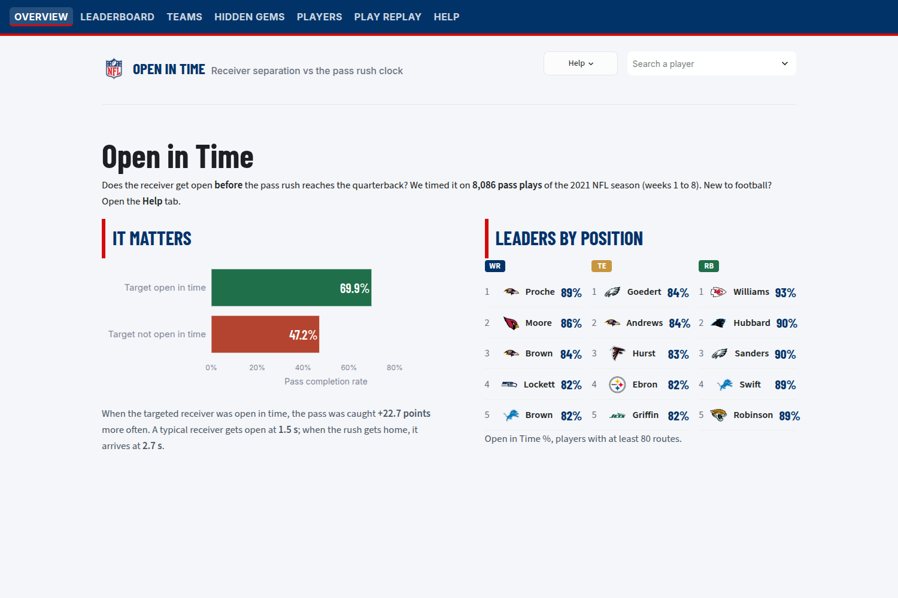
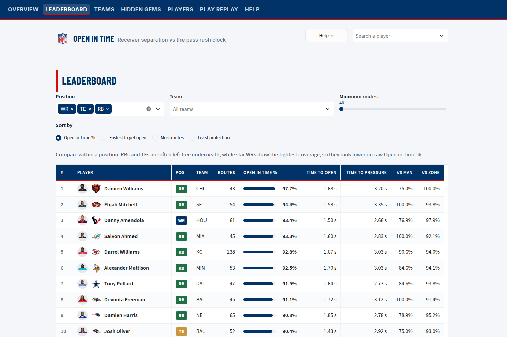
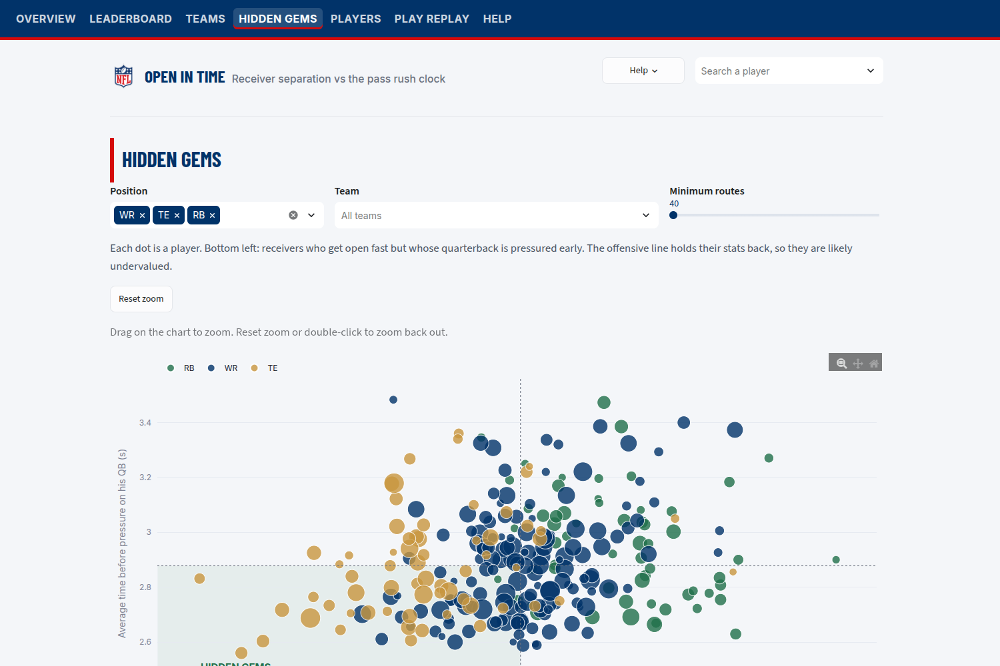
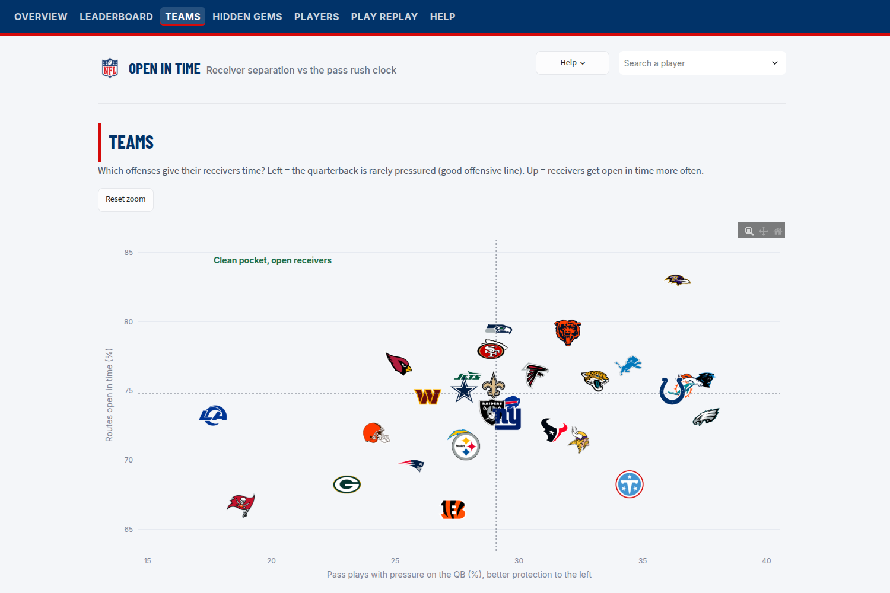
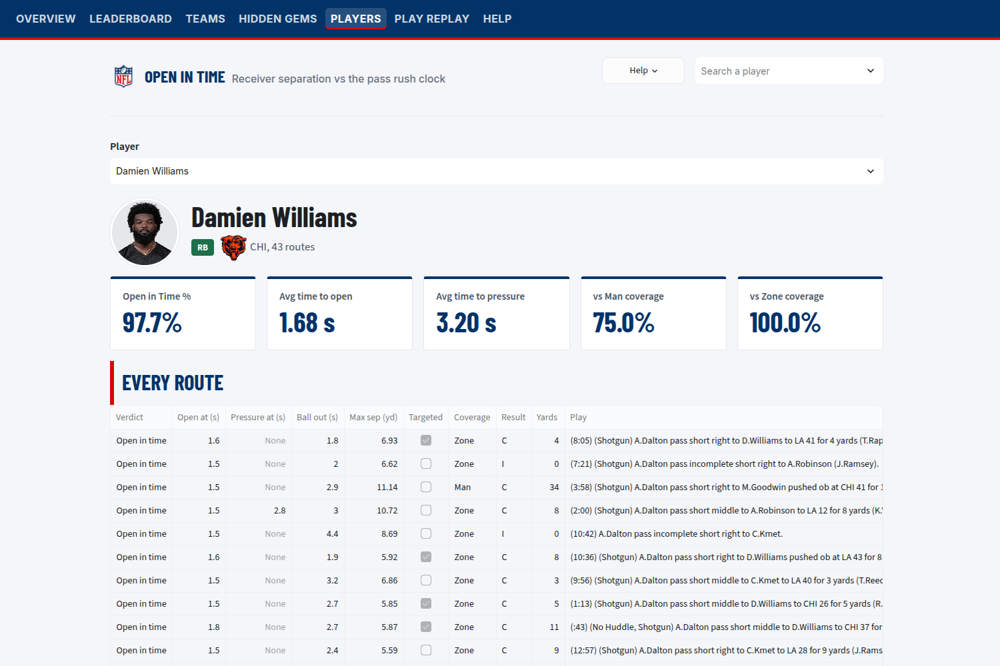
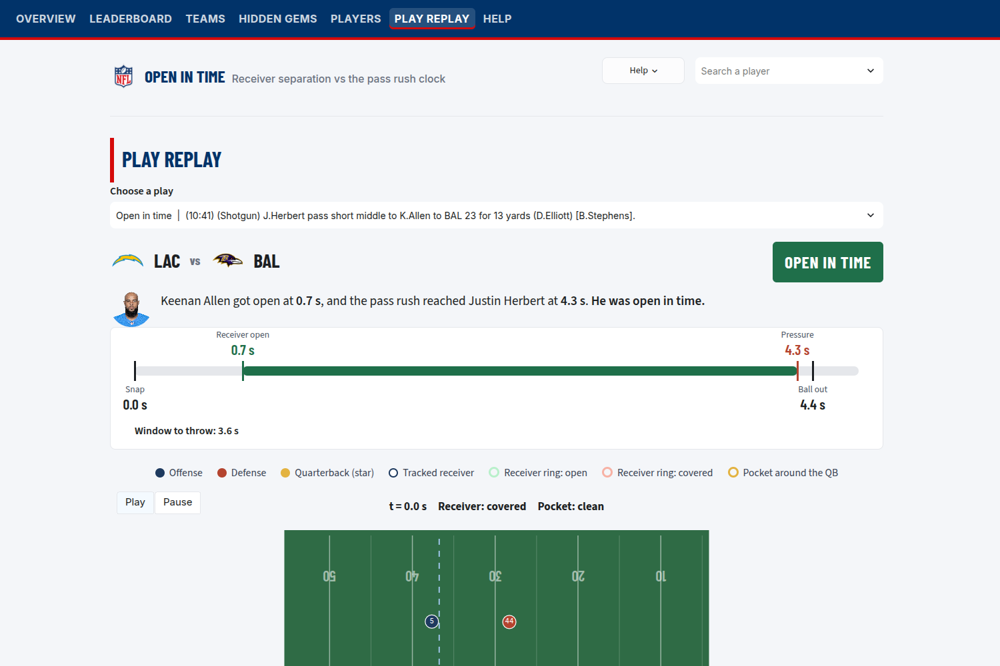
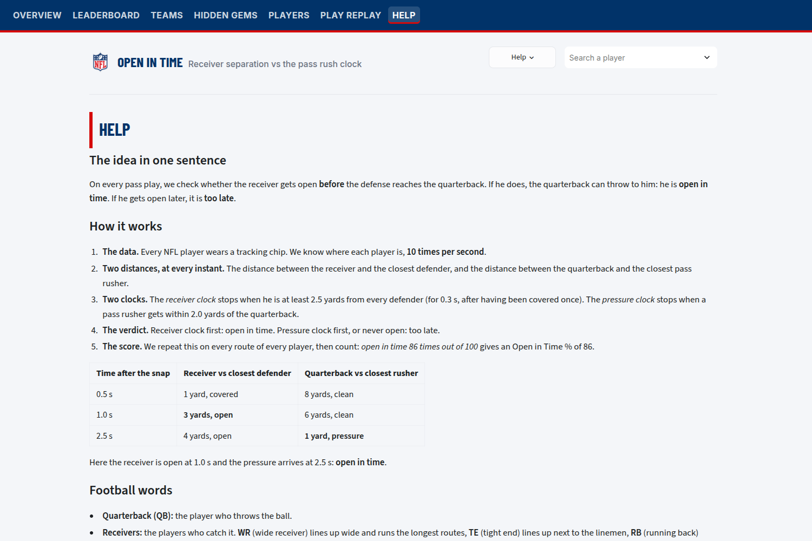

# Open in Time

**NFL Big Data Bowl Paris (AWS x NFL), Epitech.** A tool for scouts, coaches and broadcasters, focused on WR, TE and RB.

**Authors:** Deniz DEMIR, Donata CONTANT

We built **Open in Time**, a metric and a Streamlit app that measures whether a WR, TE or RB gets open while his quarterback can still throw, using 2021 NFL tracking data (weeks 1 to 8, 8,086 pass plays). A route counts as *open in time* when the receiver earns 2.5 yards of separation from the nearest defender before any pass rusher gets within 2 yards of the QB. When the targeted receiver was open in time, passes were completed **69.9%** of the time versus **47.2%** when he was not (+22.7 points, z = 16.5), so space only matters if it arrives before the pressure. Scouts can use it to spot receivers who get open fast but are held back by a weak offensive line, coaches to know who to trust when protection breaks down, and broadcasters to show on a replay exactly why a play died.



## What it reveals

- **Timing decides the play.** Targeted receivers open in time are caught 69.9% of the time, against 47.2% otherwise (6,912 targeted attempts).
- **The race is tight.** A typical receiver gets open 1.5 s after the snap; when the pass rush gets home, it arrives at 2.7 s.
- **Position matters.** RBs (86%) and TEs (76%) are open in time more often than WRs (70%): defenses leave them free underneath, so players should be compared within a position.
- **Star WRs pay for their reputation.** Davante Adams (57%), Mike Evans (56%) and Ja'Marr Chase (54%) rank low because they draw the tightest coverage, which is a story in itself for broadcasters.
- **Quarterback style shows up.** Baltimore is often pressured yet its receivers stay open in time (ball out at 3.1 s, median), while Tampa Bay's quick release (2.6 s) leaves receivers less time to get open.

## Who would use it

- **Scouts:** the Hidden gems view finds receivers who get open fast but play behind a weak offensive line, so their raw stats undersell them.
- **Coaches:** the player card shows who gets open before the pressure, and against man or zone coverage, to know who to trust when protection breaks down.
- **Broadcasters:** the play replay shows the race between the two clocks to explain on air why a play worked or died.

## How it works

1. **Tracking data:** the position of every player, 10 times per second, from the snap to the throw (or the sack).
2. **Receiver clock:** the first moment the receiver is at least 2.5 yards from every defender, held for 0.3 s, after having been covered once (the cushion given at the snap does not count).
3. **Pressure clock:** the first moment a pass rusher gets within 2 yards of the quarterback, once the QB has cleared the line.
4. **Verdict:** receiver clock first = *open in time*; pressure first, or never open = *too late*.
5. **Open in Time %:** share of a player's routes that were open in time (players with 40+ routes).

All thresholds are in `config.py`.

## The app

| Tab | What it shows |
|---|---|
| **Overview** | The key result (completion rate with vs without the target open in time) and the top 5 WR, TE and RB. |
| **Leaderboard** | Every receiver ranked, with headshot, team logo, filters (position, team, min routes) and sorting. |
| **Hidden gems** | Time to get open vs time before pressure: receivers who get open fast behind a weak line are undervalued. |
| **Teams** | The 32 offenses placed by QB protection (pressure rate) and how often their receivers get open in time. |
| **Players** | One player's card: Open in Time %, average clocks, man vs zone coverage, and every route with its verdict. |
| **Play replay** | A real play animated from above, with the two clocks, a timeline of the throwing window and the verdict. |
| **Help** | The idea, the method, football vocabulary and a guide to every tab. A **Help** button in the top bar explains the current page. |

| Leaderboard | Hidden gems |
|---|---|
|  |  |

| Teams | Player card |
|---|---|
|  |  |

| Play replay | Help |
|---|---|
|  |  |

## How to run

1. Download the data from https://github.com/ThompsonJamesBliss/nfl-big-data-bowl-regional-event-data and put its `data/` folder at the root of this repo (`data/games.csv`, `data/plays.csv`, `data/players.csv`, `data/pffScoutingData.csv`, `data/tracking/...`). The data is not committed (about 1 GB).
2. Install the dependencies, compute the metric (about 10 seconds, results written to `cache/`), then launch the app and open http://localhost:8501.

Linux / macOS:

```bash
python -m venv .venv && source .venv/bin/activate
pip install -r requirements.txt
python compute.py          # add --sample 3 to test on 3 games first
streamlit run app.py
```

Windows (PowerShell):

```powershell
python -m venv .venv; .venv\Scripts\Activate.ps1
pip install -r requirements.txt
python compute.py
streamlit run app.py
```

## Project structure

```
config.py          all thresholds (separation, pressure, minimum routes)
compute.py         reads the tracking data, computes both clocks, writes cache/*.parquet
app.py             Streamlit app (reads cache/ only, starts instantly)
assets/            team logos, NFL logo, nflId to headshot mapping
screenshots/       captures of every tab
.streamlit/        app theme
```

## Data

- NFL Big Data Bowl regional event data: 2021 season, weeks 1 to 8, 122 games, 8,557 pass plays (8,086 kept after removing scrambles and plays without a snap).
- Files used: `games.csv`, `plays.csv`, `players.csv`, `pffScoutingData.csv` (roles: passer, route runner, pass rusher) and `tracking/` (10 frames per second).
- Team logos are stored in `assets/logos/`. Player headshots are loaded from nfl.com (internet needed), using the nflId to headshot mapping from the public nflverse players table (`assets/headshots.csv`).

## Tech stack

Python 3, pandas and NumPy (vectorized distance computation, no frame-by-frame loops), PyArrow (parquet cache), Plotly (charts and play animation), Streamlit (web app).

## Limitations

- Tracking stops shortly after the throw, so we judge separation up to the release, not at the catch.
- Open in Time depends on the route: short routes get open earlier than deep ones, so compare players within a position.
- Thresholds (2.5 yards, 2 yards) are simple and fixed; they can be tuned in `config.py`.
